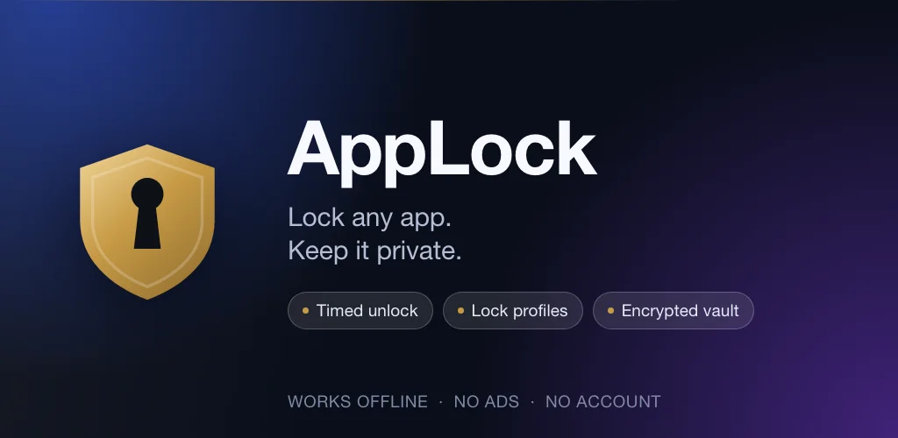
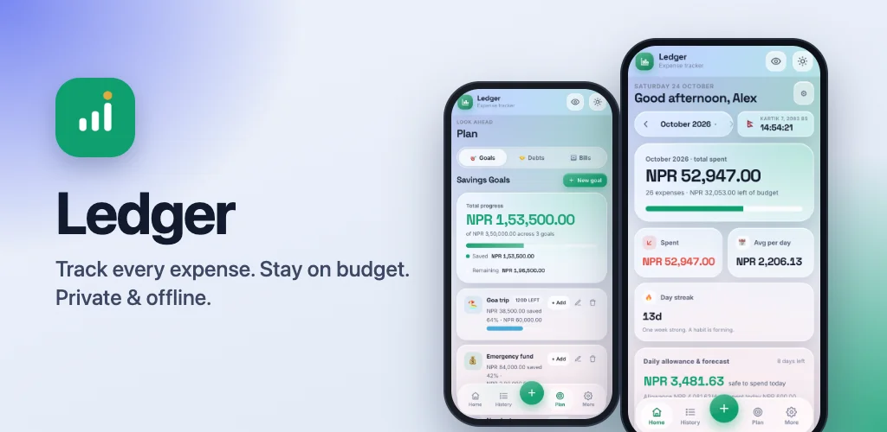
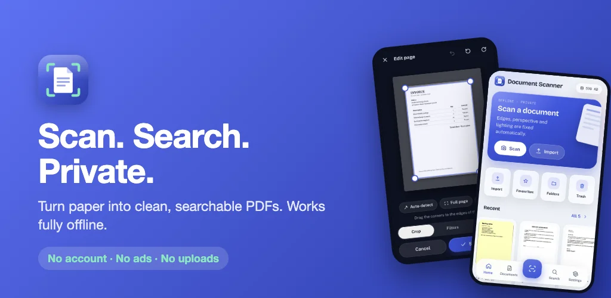
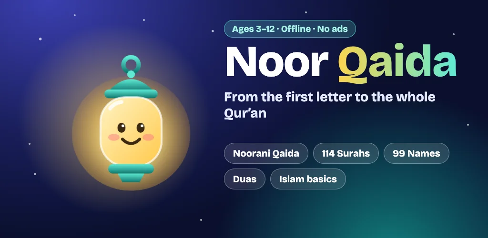

<!--
  Sabid Ansari (@ansarisabid84) — Lead Software Engineer at Accenture.
  Java · Spring Boot · Python · Django · React · AWS · Android & iOS. Hyderabad, India.
-->

<a href="https://www.linkedin.com/in/ansarisabid">
  
</a>

<p align="center">
  
</p>

<p align="center">
  I build, deploy and run production platforms end to end — backend services, web and mobile frontends, cloud infrastructure and security.<br>
  At <strong>Accenture</strong> I lead a <strong>12-member cross-functional team</strong>; outside work I ship <strong>offline-first apps on Google Play</strong>.
</p>

<p align="center">
  <a href="https://www.linkedin.com/in/ansarisabid"></a>
  <a href="#02--selected-work"></a>
  <a href="https://www.linkedin.com/in/ansarisabid"></a>
</p>

<p align="center">
  
  
  
  
  
</p>

<p align="center"><sub><a href="#01--about">About</a> &nbsp;·&nbsp; <a href="#02--selected-work">Selected work</a> &nbsp;·&nbsp; <a href="#03--at-work">At work</a> &nbsp;·&nbsp; <a href="#04--stack">Stack</a> &nbsp;·&nbsp; <a href="#05--experience">Experience</a> &nbsp;·&nbsp; <a href="#06--find-me-online">Find me online</a></sub></p>

---

## 01 — About

Engineering lead with 5+ years across backend, frontend, mobile and cloud. I care about the unglamorous parts that keep products alive — clean migrations, hardened infrastructure, reliable deployments and teams that ship with confidence.

```ts
const sabid = {
  name: "Sabid Ansari",
  role: "Lead Software Engineer @ Accenture",
  basedIn: "Hyderabad, India · UTC+5:30",
  leads: "12-member cross-functional team (backend, frontend, DevOps)",
  builds: ["Java 21 + Spring Boot", "Python + Django / DRF", "React · Next.js", "Kotlin · SwiftUI · Capacitor"],
  cloud: ["AWS (VPC, EC2, ALB, Lambda, ACM)", "Docker", "GitHub CI/CD", "Linux"],
  recently: ["Linode → AWS migration", "BitSight 640 → 730", "Post-merger platform integration"],
  shipped: ["AppLock", "Ledger", "Document Scanner", "Noor Qaida"],
  openTo: "Engineering Lead · Technical Lead · Senior Software Engineer",
};
```

---

## 02 — Selected work

Apps I designed, built and published on my own — all live on Google Play, all fully offline, no ads.

<!-- ─────────────── 01 · AppLock ─────────────── -->

<a href="https://play.google.com/store/apps/details?id=com.sabid.applock">
  
</a>

### 01 · AppLock — Privacy-First App Locker

**Lock any app, keep it private.** A native app locker for Android and iOS with **400+ monthly active users**.

- **Native on both platforms** — Kotlin + Jetpack Compose + Room on Android; SwiftUI with Apple's Screen Time APIs (FamilyControls, ManagedSettings) on iOS
- AccessibilityService-based lock engine with biometric unlock, timed unlock and lock profiles
- **Fully offline** — no ads, no account, no tracking, no cloud costs

<p>
  
  
  
  
  
</p>

<a href="https://play.google.com/store/apps/details?id=com.sabid.applock"></a>
<a href="https://github.com/ansarisabid84/m-applock"></a>

<br><br>

<!-- ─────────────── 02 · Ledger ─────────────── -->

<a href="https://play.google.com/store/apps/details?id=com.sabid.ledgerapp">
  
</a>

### 02 · Ledger — Offline Personal Finance Tracker

**Track every expense, stay on budget.** One React codebase shipped to Android and iOS.

- Transaction tracking by payment method with chart-driven dashboards and month-wise views
- Settlement and carry-forward logic, plus a borrowed/lent ledger
- Biometric app lock and OS-scheduled local reminders; evolved from a Supabase cloud-sync build to a fully offline one

<p>
  
  
  
  
</p>

<a href="https://play.google.com/store/apps/details?id=com.sabid.ledgerapp"></a>
<a href="https://github.com/ansarisabid84/m-ledger"></a>

<br><br>

<!-- ─────────────── 03 · Document Scanner ─────────────── -->

<a href="https://play.google.com/store/apps/details?id=com.sabid.documentscanner">
  
</a>

### 03 · Document Scanner — Scan, Search, Private

**Paper to searchable PDF, entirely on the device.**

- Camera capture with **on-device OCR** (Tesseract.js) — nothing is uploaded
- PDF creation and viewing (jsPDF, pdf.js), biometric-protected secure storage and privacy screen
- No account, no ads, no uploads

<p>
  
  
  
  
</p>

<a href="https://play.google.com/store/apps/details?id=com.sabid.documentscanner"></a>
<a href="https://github.com/ansarisabid84/m-document-scanner"></a>

<br><br>

<!-- ─────────────── 04 · Noor Qaida ─────────────── -->

<a href="https://play.google.com/store/apps/details?id=com.sabid.noorqaida">
  
</a>

### 04 · Noor Qaida — Learn Quran Kids

**From the first letter to the whole Qur'an.** A Noorani Qaida (Arabic reading) app for children aged 3–12.

- Fully offline with zero cloud cost; text-to-speech pronunciation
- Multi-script typography (Arabic, Urdu, Hindi) and a modern glass-style UI designed for kids

<p>
  
  
  
</p>

<a href="https://play.google.com/store/apps/details?id=com.sabid.noorqaida"></a>
<a href="https://github.com/ansarisabid84/m-noorqaida"></a>

<br><br>

### Also on GitHub

| Project | What it is | Stack |
|:---|:---|:---|
| [**EMS**](https://github.com/ansarisabid84/ems) | Multi-tenant education management system — row-level tenancy, six roles, full RBAC permission matrix | Django REST Framework · React |
| [**custom_bash**](https://github.com/ansarisabid84/custom_bash) | Bash CLI to manage and connect to many SSH servers by alias, with SCP and fuzzy matching | Bash · SSH |

---

## 03 — At work

Highlights from Accenture and TalentSprint (part of Accenture). Code is proprietary; results are not.

| Initiative | Outcome | Stack |
|:---|:---|:---|
| **Cloud migration** | Moved production workloads from Linode to AWS; designed VPC, EC2, ALB, NAT Gateway and ACM environments | AWS · Docker |
| **Security hardening** | Raised the organization's **BitSight score from 640 to 730** by remediating infrastructure and application vulnerabilities | AWS · Linux |
| **Post-merger integration** | Leading platform consolidation and infrastructure alignment after Accenture's acquisition of TalentSprint | Java · Python · AWS |
| **API automation & modernization** | **+40%** operational efficiency, **−25%** manual effort, **99.5%** uptime | Java 21 · Spring Boot |
| **Video processing pipeline** | Raw video → encrypted HLS streams with subtitles; **60%** faster processing, **75+ hours/month** saved | Python · FFmpeg |
| **Internal operations dashboard** | RBAC dashboard automating enrollment across Moodle and Open edX, with finance reporting | Java 21 · Spring Boot · MySQL |
| **Open edX operations** | Customization, deployments and production operations of Open edX (Quince) for large learner cohorts | Python · Django · Docker |
| **Odoo order management** | Replaced a legacy Drupal system; **−25%** manual effort on orders, inventory and reporting | Odoo · Python · PostgreSQL |

---

## 04 — Stack

<p align="center">
  <picture>
    <source media="(prefers-color-scheme: light)" srcset="https://skillicons.dev/icons?i=java,spring,python,django,flask,react,nextjs,ts,js,kotlin,swift,nodejs,express,aws,docker,linux,mysql,postgres,mongodb,redis,githubactions,git&perline=11&theme=light" />
    
  </picture>
</p>

| Area | Technologies |
|:---|:---|
| **Backend** | Java 21 · Spring Boot · Spring MVC · Python · Django / DRF · Flask · Node.js / Express · REST APIs |
| **Frontend & mobile** | React · Next.js · TypeScript · Capacitor · Ionic Angular · Kotlin + Jetpack Compose · SwiftUI |
| **Cloud & DevOps** | AWS (EC2, VPC, ALB, NAT Gateway, ACM, Lambda) · Docker · GitHub CI/CD · Linux |
| **Data** | MySQL · PostgreSQL · MongoDB · Redis · SQLite |
| **Platforms** | Open edX · Moodle · Odoo |
| **Practices** | RBAC · Caching · Design Patterns · SOLID · Security hardening · Team leadership |

---

## 05 — Experience

| Period | Company | Role |
|:---|:---|:---|
| Dec 2025 – Present | **Accenture** | Lead Software Engineer (Packaged App Development Team Lead) |
| Mar 2021 – Nov 2025 | **TalentSprint** (part of Accenture) | Intern → Associate → Software Engineer → Senior Software Engineer → Deputy Manager – Technology → Lead Software Engineer |
| Aug 2020 – Feb 2021 | **BirgunjBazar** | Freelance developer — e-commerce website and Android app |

**Education** — B.Tech, Computer Science & Engineering · Lovely Professional University · 2020 · GPA 8.14 / 10

---

## 06 — Find me online

<p align="center">
  <a href="https://www.linkedin.com/in/ansarisabid"></a>
  <a href="https://github.com/ansarisabid84"></a>
  <a href="https://play.google.com/store/apps/details?id=com.sabid.applock"></a>
</p>

<p align="center">
  <a href="https://www.linkedin.com/in/ansarisabid"></a>
</p>

<p align="center"><sub>© 2026 Sabid Ansari · Hyderabad, India</sub></p>
